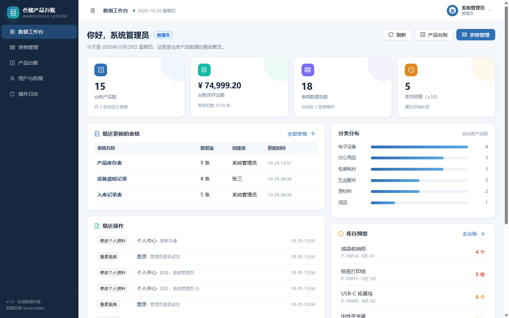
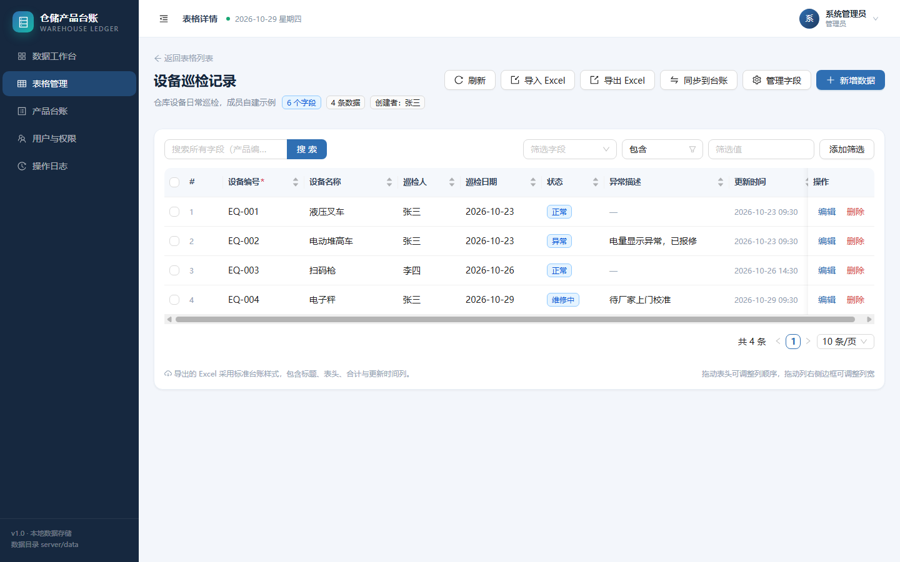
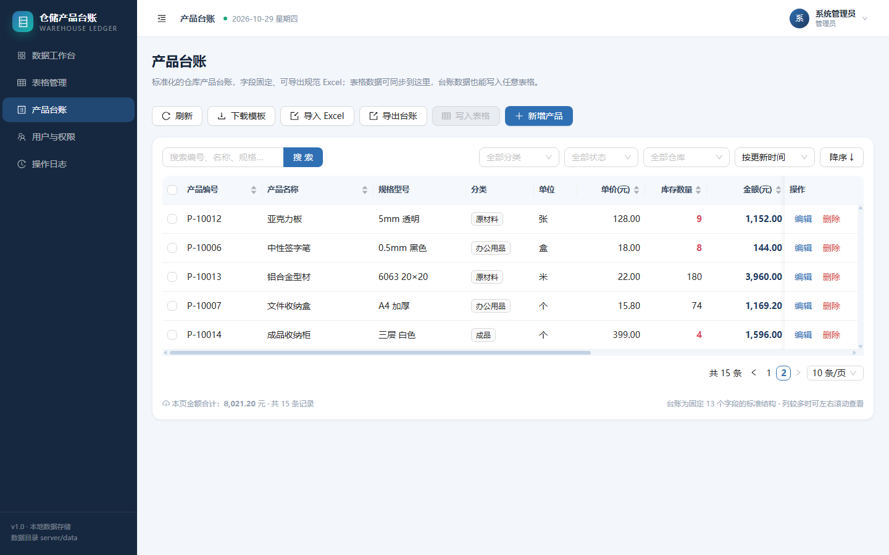
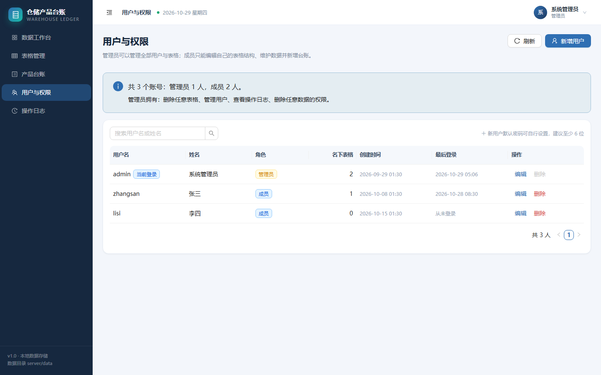
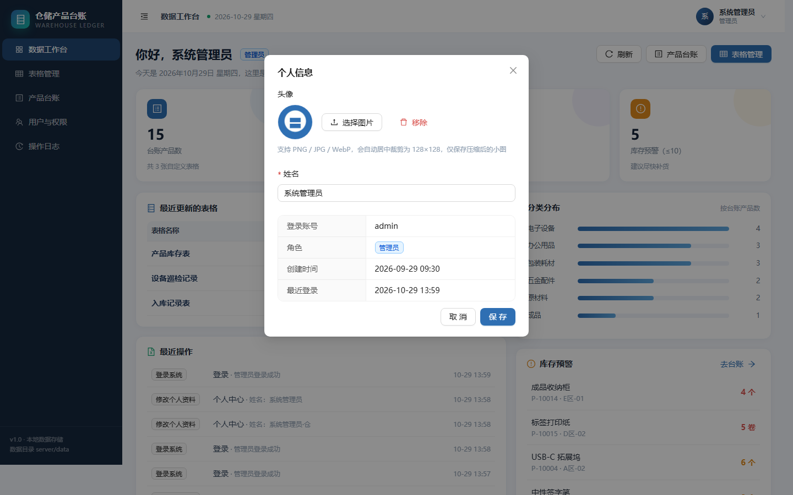

# 仓储产品台账管理系统

一个前后端一体的仓库产品数据管理项目：**自定义表格**（像 Excel 一样自由加字段）负责日常录入，**标准产品台账**负责统一归档，两者数据可双向互通，并支持带格式的 Excel 导入导出。


## 功能一览

### 表格管理（核心）
- 新建 / 重命名 / 删除表格，内置 3 套模板：空白表格、产品库存表（字段与台账对齐）、入库记录表
- 字段自由扩展：文本、多行文本、数字、下拉选项、日期；可设置必填、列宽
- 表头即拖即改：拖动表头调整列顺序、拖动列右侧边框调整列宽（80–480px），自动保存
- 数据增删改查：分页、关键字全字段搜索、多条件字段筛选（等于/包含/大于/小于/区间/为空…）、列排序
- 搜索词、筛选条件、排序与分页都写入地址栏，刷新不丢、链接可分享
- 批量删除、按字段类型校验（数字列非法值会被拒绝）
- 导出 Excel：台账式排版（标题、元信息、蓝底表头、斑马纹、冻结表头、合计行）
- 导入 Excel：上传 → 选工作表 → 字段映射（自动猜列）→ 追加或按业务键更新，失败行明细可查

### 产品台账
- 13 个固定字段（编号、名称、规格、分类、单位、单价、库存、金额、仓库、供应商、状态、备注、更新时间）
- 金额自动计算 = 单价 × 库存；库存 ≤ 10 红色高亮预警
- 分类 / 状态 / 仓库筛选，关键字搜索，多字段排序
- 导出台账 Excel、下载空白导入模板、Excel 批量导入
- 选中台账数据 → 一键写入任意自定义表格（字段映射）

### 数据互通
- **表格 → 台账**：把某张表格（全部或选中行）按字段映射同步到台账，可按产品编号更新或新增
- **台账 → 表格**：把台账数据写回任意表格，自动猜字段对应关系

### 用户与权限
- 登录 / 退出 / 修改密码、自助修改姓名与头像，JWT 鉴权，登录失败限流
- 头像在浏览器端居中裁剪并压缩为 128×128 JPEG，仅保存小图
- 两种角色：

| 能力 | 管理员 admin | 成员 member |
| --- | --- | --- |
| 查看表格与数据 | ✅ | ✅ |
| 新建表格 / 维护字段 / 调列宽列序 | ✅ | ✅（自己的表格） |
| 录入数据 | ✅ | ✅ |
| 编辑自己录入的数据 | ✅ | ✅ |
| 编辑本表格内的所有数据 | ✅ | ✅（自己是该表创建者时） |
| 编辑他人表格中他人录入的数据 | ✅ | ❌ |
| 删除自己的数据 | ✅ | ✅ |
| 删除他人数据 | ✅ | ❌ |
| 删除表格 | ✅ | ❌ |
| 新增 / 编辑 / 删除用户 | ✅ | ❌ |
| 查看操作日志 | ✅ | ❌ |

- 至少保留一名管理员；不能删除当前登录账号
- 删除用户时，其名下表格与录入的数据自动转交给当前管理员，不会变成孤儿数据
- 22 类关键操作写入操作日志（登录、增删改、导入导出、同步、用户管理等），保留最近 500 条

### 工作台
- 统计卡片：台账产品数、库存金额、表格数据条数、库存预警数
- 最近更新的表格、最近操作、分类分布、库存预警列表

## 技术栈

| 层 | 选型 |
| --- | --- |
| 前端 | React 18、TypeScript、Vite 6、Ant Design 5、React Router 6、Axios、Day.js |
| 后端 | Node.js（ESM）、Express 4、JWT、bcryptjs、ExcelJS、Multer、compression |
| 存储 | JSON 文件（`server/data/db.json`），原子写入，无需数据库 |

## 快速开始

环境要求：Node.js ≥ 20（开发使用 v24）。

```bash
cd product-ledger
npm install

# 开发模式：API 4399 + 前端 5173（自动代理 /api）
npm run dev
# 打开 http://127.0.0.1:5173
```

生产模式（单端口，前端由后端托管）：

```bash
npm run build     # 构建前端到 web/dist
npm start         # 启动服务，访问 http://127.0.0.1:4399
```

首次启动会自动写入演示数据（3 个用户、3 张表格、15 条台账、18 条表格数据）。

### 演示账号

| 账号 | 密码 | 角色 |
| --- | --- | --- |
| `admin` | `admin123` | 管理员 |
| `zhangsan` | `member123` | 成员 |
| `lisi` | `member123` | 成员 |

> 部署到内网前请先修改默认密码（登录后右上角「修改密码」）。

## 一键启动（Windows 桌面）

不想开命令行？项目自带一套双击即用的脚本：

| 文件 | 作用 |
| --- | --- |
| `创建桌面快捷方式.cmd` | 在桌面生成「仓储产品台账」「停止台账系统」两个快捷方式（带应用图标） |
| `启动台账系统.cmd` | 检查 Node 环境（>= 20）→ 必要时 `npm install`，前端源码有更新时自动 `npm run build` → 后台启动服务 → 自动打开浏览器 |
| `停止台账系统.cmd` | 校验进程身份后停止本系统的 Node 服务（不会误杀占用 4399 的其他程序） |
| `启用局域网访问.cmd` | 以管理员权限放行 Windows 防火墙的 4399 端口（仅专用/域网络）；支持 `-AllowPublic`、`-Restore` |

启动脚本 `scripts/start-app.ps1` 支持 `-Port 5000`（通过 `PORT` 环境变量传给服务端）、`-Rebuild`（强制重建前端）、`-NoBrowser`（不打开浏览器）。实际动作：检查 Node 版本 → 必要时安装依赖 → `web/dist` 缺失或前端源码比构建产物新时自动构建 → 后台运行 `node server/src/index.js`，PID 写入 `logs/server.pid` → 轮询 `/api/health` 直到就绪 → 打开浏览器。服务输出写到 `logs/server.log` 与 `logs/server.err.log`（每次启动前保留一份 `.prev`）。如果端口已被**本系统**占用则跳过启动；被其他程序占用会直接报错，不会把别人的页面当成自己的。

停止脚本 `scripts/stop-app.ps1` 支持 `-Port 5000` 与 `-NonInteractive`。它只停「PID 文件记录且确实在指定端口监听」或「指定端口上确实属于本项目的 node.exe」的进程；PID 文件与 `-Port` 不一致时不会误杀其他实例。`-NonInteractive` 供脚本/计划任务调用，结束时不再等待回车。

> 服务实际由 `scripts/run-server.cmd` 拉起（由 `start-app.ps1` 通过 ShellExecute 启动）。这样常驻的 node 进程不会继承调用方的标准输出句柄，`powershell -File scripts\start-app.ps1 -NoBrowser | Select-Object -Last 5` 这类管道/自动化调用才能在几秒内正常返回。

## 局域网共享（同一 WiFi 的多台电脑）

可以。这套系统是「一个服务端 + 浏览器客户端」的结构：**所有电脑访问同一台机器的 4399 端口，看到的就是同一份数据**（`server/data/db.json`）。

1. 在当服务器的电脑上双击「仓储产品台账」，启动窗口会打印本机局域网地址；
2. 首次使用时双击「启用局域网访问」，放行防火墙（管理员权限，只放行专用/域网络；如果当前网络被 Windows 识别为「公用网络」，脚本会询问是否改成「专用网络」——公司/家庭内网选 y，公共 WiFi 选 n）；
3. 另一台电脑用浏览器打开 `http://<服务器IP>:4399`，例如 `http://192.168.1.41:4399`；
4. 各人用自己的账号登录，管理员/成员权限、操作日志、每条数据「谁录入/谁修改」都会按账号记录。

注意事项：

- 服务器电脑关机、睡眠或退出登录后，其他电脑就访问不了；建议在路由器里给这台机器做 DHCP 保留（固定 IP），否则 IP 变化后访问地址要跟着改。
- 路由器如开启「AP 隔离 / 访客网络」，设备之间无法互访，需要关闭。
- 两台电脑要连同一个路由器（同一网段）；跨网段或外网访问需要端口映射/内网穿透，不建议把 4399 直接暴露到公网。
- 并发：JSON 单文件存储在几十人以内、以录入和查询为主的场景足够；写操作按事件循环合并落盘（毫秒级），但没有行级锁，多人同时改同一行时以最后一次保存为准。停止服务是强制终止进程，仍建议在无人录入时停止。
- 局域网内是 HTTP 明文，仅适合可信内网；正式使用前先改掉 `admin/admin123` 默认密码。
- 手机连同一个 WiFi 也能用浏览器打开同一地址（页面响应式，表格支持横向滚动）。

### 更新代码后

`web/dist` 不纳入版本库。拉取新代码后直接双击「启动台账系统」即可：脚本会比对 `web/src`、`web/public`、`web/index.html` 等与 `dist/index.html` 的时间戳，自动重建前端；也可以手动 `npm run build`，或执行 `start-app.ps1 -Rebuild` 强制重建。

### 台账编辑权限

表格数据按「创建者 / 管理员」控制编辑与删除；**产品台账是共享主数据，任何登录用户都可以修改台账记录，但只有创建者或管理员能删除**。如需更严格的台账编辑权限，可在 `server/src/routes/ledger.js` 的 `PATCH /:id` 中补充归属校验。

## 常用命令

```bash
npm run dev        # 同时启动 API 与前端
npm run build      # 构建前端
npm start          # 生产模式启动（需先 build）
npm run seed       # 重新写入演示数据（会覆盖现有数据）
npm run test:api   # 接口回归测试（独立临时数据库，不影响正式数据）
```

## 目录结构

```
product-ledger/
├─ 启动台账系统.cmd            # 双击：启动服务并打开浏览器
├─ 停止台账系统.cmd            # 双击：停止服务
├─ 创建桌面快捷方式.cmd        # 双击：在桌面创建带图标的快捷方式
├─ 启用局域网访问.cmd          # 右键或以管理员运行：放行防火墙 4399 端口
├─ scripts/                   # 一键启动相关 PowerShell 脚本
├─ logs/                      # 一键启动时的服务日志（server.log / server.err.log）
├─ server/                  # 后端（Express，纯 ESM，无需构建）
│  ├─ src/
│  │  ├─ index.js           # 入口：中间件、路由挂载、静态托管、错误处理
│  │  ├─ db.js              # JSON 存储：加载 / 原子保存 / 合并写
│  │  ├─ auth.js            # JWT、鉴权中间件、操作日志
│  │  ├─ store.js           # 表格与数据的规范化、校验
│  │  ├─ excel.js           # Excel 解析 / 台账样式生成
│  │  ├─ query.js           # 筛选、搜索、排序、分页
│  │  ├─ templates.js       # 表格模板
│  │  ├─ ledger-fields.js   # 台账字段定义
│  │  ├─ seed.js            # 演示数据
│  │  └─ routes/            # auth / users / tables / ledger / stats
│  ├─ test/api.test.js      # 80 项接口回归测试
│  └─ data/                 # 运行时数据（db.json、jwt.secret）
└─ web/                     # 前端（React + Vite）
   ├─ src/
   │  ├─ pages/             # Login / Dashboard / TableList / TableDetail / Ledger / Users / Logs
   │  ├─ components/        # AppLayout / ErrorBoundary / RowFormModal / ColumnManagerModal / ImportWizardModal / SyncLedgerModal / ToTableModal
   │  ├─ api.ts             # 接口封装与文件下载
   │  ├─ auth.tsx           # 登录态
   │  ├─ useUrlQuery.ts     # 把筛选 / 分页 / 排序同步到地址栏
   │  ├─ avatar.ts          # 头像裁剪压缩
   │  ├─ styles.css         # 设计系统
   │  └─ types.ts
   └─ scripts/build.mjs     # 构建脚本（规避本机临时目录权限问题）
```

## 数据与备份

- 所有业务数据保存在 `server/data/db.json`，直接复制该文件即可备份 / 迁移
- 删除 `db.json` 后重启服务会重新生成演示数据
- `server/data/jwt.secret` 为令牌密钥，删除后所有登录态失效

## Excel 导入说明

1. 仅支持 `.xlsx`（单文件 ≤ 20MB，单表最多读取 5000 行）
2. 第一行作为表头，系统会按字段名自动匹配列，也可手动指定
3. 追加模式：全部作为新数据写入；更新模式：按选定业务键（如产品编号）匹配，存在则更新、不存在则新增
4. 数字列必须是合法数字，日期列支持 `2026-10-29`、`2026/10/29`、Excel 日期格式
5. 导入结果会显示新增 / 更新 / 失败数量及失败原因（最多展示 30 条）

## 接口概览

| 方法 | 路径 | 说明 |
| --- | --- | --- |
| POST | `/api/auth/login` | 登录 |
| GET | `/api/auth/me` | 当前用户 |
| POST | `/api/auth/password` | 修改密码 |
| PATCH | `/api/auth/profile` | 修改姓名 / 头像 |
| GET/POST | `/api/tables` | 表格列表 / 新建 |
| GET/PATCH/DELETE | `/api/tables/:id` | 表格详情 / 修改 / 删除（管理员） |
| GET/POST | `/api/tables/:id/rows` | 数据查询（搜索、筛选、排序、分页）/ 新增 |
| PATCH/DELETE | `/api/tables/:id/rows/:rowId` | 修改 / 删除数据 |
| POST | `/api/tables/:id/rows/batch-delete` | 批量删除 |
| GET | `/api/tables/:id/export` | 导出表格 Excel |
| POST | `/api/tables/:id/import/preview` | 上传并预览导入 |
| POST | `/api/tables/:id/import/commit` | 提交导入（映射 + 模式） |
| POST | `/api/tables/:id/sync-ledger` | 表格数据同步到台账 |
| GET/POST | `/api/ledger` | 台账查询 / 新增 |
| PATCH/DELETE | `/api/ledger/:id` | 台账修改 / 删除 |
| GET | `/api/ledger/export` | 台账导出 |
| GET | `/api/ledger/template` | 导入模板下载 |
| POST | `/api/ledger/to-table` | 台账数据写入表格 |
| GET/POST/PATCH/DELETE | `/api/users` | 用户管理（管理员） |
| GET | `/api/stats` | 工作台统计 |
| GET | `/api/logs` | 操作日志（管理员） |

## 页面预览

| 工作台 | 表格详情 |
| --- | --- |
|  |  |

| 产品台账 | 用户与权限 |
| --- | --- |
|  |  |

| 个人资料（头像 / 姓名） |
| --- |
|  |

## 已知说明

- 数据存储为单文件 JSON，适合中小团队内网使用；如需高并发 / 多实例部署，可将 `server/src/db.js` 替换为数据库实现，路由层无需改动
- 前端构建脚本 `web/scripts/build.mjs` 会把临时目录指向 `web/.tmp`，用于规避本机 `%TEMP%` 下 esbuild 的 `Access is denied` 问题
- 页面按路由懒加载，antd 独立缓存为 vendor 分包；服务端开启 gzip，`/assets` 长缓存、HTML 不缓存
- 收到 SIGINT / SIGTERM 时会先把内存中的改动刷盘再退出
